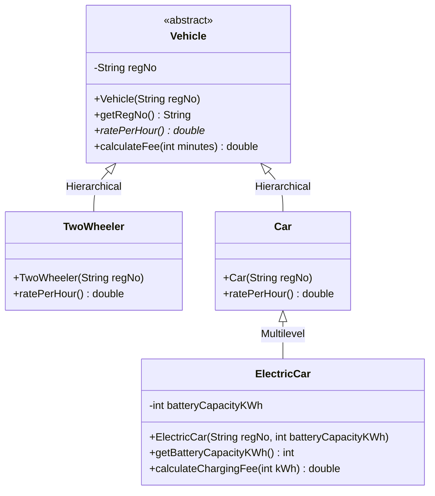

# Task 6: Design the Inheritance Hierarchy

**Bloom's Level: K4 – Analyse | Marks: 4**

---

## 1. Inheritance Hierarchy Design



### Types of Inheritance Employed
1. **Hierarchical Inheritance**:
   - `Vehicle` acts as the abstract superclass with two direct child subclasses: `TwoWheeler` and `Car`.
2. **Multilevel Inheritance**:
   - `Vehicle` $\rightarrow$ `Car` $\rightarrow$ `ElectricCar`.
   - `ElectricCar` extends `Car`, inheriting car parking behaviors and rates while adding specialized EV battery and charging properties.

---

## 2. Inherited vs. Added Members

| Class | Inherited from Superclass | Added in Subclass |
| :--- | :--- | :--- |
| **`TwoWheeler`** | `regNo`, `getRegNo()`, `calculateFee(int)` | Implements `ratePerHour()` returning Rs 10.0/hr. |
| **`Car`** | `regNo`, `getRegNo()`, `calculateFee(int)` | Implements `ratePerHour()` returning Rs 30.0/hr. |
| **`ElectricCar`** | `regNo`, `getRegNo()`, `calculateFee(int)`, Car's Rs 30.0/hr rate | Field `batteryCapacityKWh`, method `calculateChargingFee(int kWh)` at Rs 12.0/kWh. |

---

## 3. Role and Usage of `super`

1. **`super(...)` Constructor Invocation**:
   - In Java, the subclass constructor **must** invoke the superclass constructor as its very first statement.
   - Example: In `ElectricCar`:
     ```java
     public ElectricCar(String regNo, int batteryCapacityKWh) {
         super(regNo); // Invokes Car(regNo), which calls Vehicle(regNo)
         this.batteryCapacityKWh = batteryCapacityKWh;
     }
     ```
2. **`super` Method Invocations**:
   - Allows a subclass to access or extend overridden superclass functionality (e.g., `super.calculateFee(minutes)`).

---

## 4. Constructor Execution Order Trace for `ElectricCar`

When evaluating `new ElectricCar("TN03C3", 50)`:
1. `java.lang.Object` default constructor executes (root of all Java classes).
2. `Vehicle(String regNo)` constructor body executes $\rightarrow$ stores `"TN03C3"`.
3. `Car(String regNo)` constructor body executes.
4. `ElectricCar(String regNo, int batteryCapacityKWh)` constructor body executes $\rightarrow$ stores `50`.

```
Execution Trace:
[1. Vehicle Constructor] Initializing regNo: TN03C3
[2. Car Constructor] Car instance ready.
[3. ElectricCar Constructor] ElectricCar ready with 50 kWh battery.
```

---

## 5. Alternative Concept & Complexity Analysis

### Inheritance (`Car is-a Vehicle`) vs. Composition (`Vehicle has-a VehicleType`)

| Criteria | Inheritance (`is-a`) | Composition (`has-a`) |
| :--- | :--- | :--- |
| **Adding a New Vehicle Type** | Requires writing a new subclass (e.g., `class Bus extends Vehicle`). Zero impact on existing classes. | Can create a new `VehicleType` instance at runtime dynamically from config/database without adding any new Java classes. |
| **Time to Compute Fee** | $O(1)$ dynamic method dispatch (vtable dereference). | $O(1)$ single field dereference (`vehicle.type.rate`). Negligible difference (~1-2 ns). |
| **Memory / Space per Object** | **Smaller**: 1 object header + fields directly embedded in `Vehicle` instance. | **Slightly larger**: 2 object headers (one for `ComposedVehicle` + one for `VehicleType`) plus reference pointer ($8\text{ bytes}$). |
| **Flexibility / Polymorphic Behavior** | Strongly typed, enables behavior specialization (e.g. EV charging logic). | Highly dynamic for data-driven rates, but requires strategy/interfaces if behaviors (not just rates) differ. |

---

## 6. Compilation and Execution

```bash
# Compilation
javac Task06/src/Vehicle.java Task06/src/TwoWheeler.java Task06/src/Car.java Task06/src/ElectricCar.java Task06/src/InheritanceDemo.java -d Task06/bin

# Execution
java -cp Task06/bin InheritanceDemo
```

### Execution Output
```
==========================================================
      TASK 6: Design the Inheritance Hierarchy            
==========================================================

--- Constructor Execution Trace: new ElectricCar("TN03C3", 50) ---
    [1. Vehicle Constructor] Initializing regNo: TN03C3
    [2. Car Constructor] Car instance ready.
    [3. ElectricCar Constructor] ElectricCar ready with 50 kWh battery.

Instance Details:
  ElectricCar [regNo=TN03C3, rate=30.0/hr]
  Parking fee for 130 min: Rs 90.0
  Charging fee for 10 kWh: Rs 120.0

--- Alternative: Composition Comparison ---
  Composed vehicle created: TN02B2 (CAR)
  Composed parking fee (130 min): Rs 90.0
==========================================================
```
